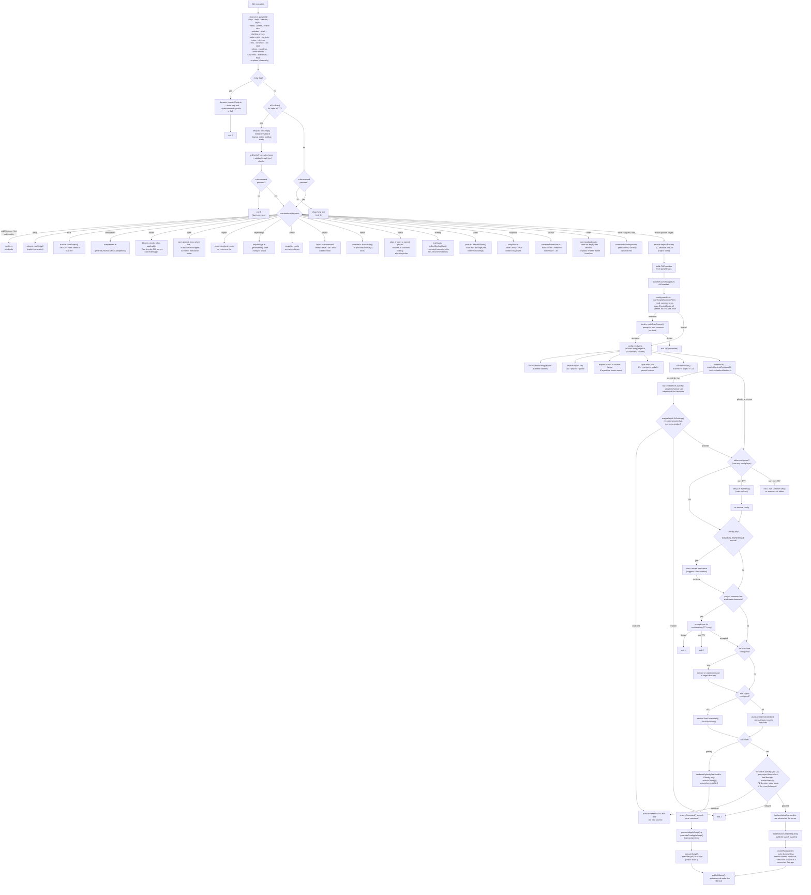
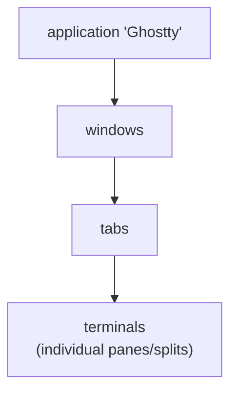

# Architecture

Technical reference for contributors.

## Module Map

| Module | Role | Side Effects | Dependencies |
|--------|------|:------------:|--------------|
| `index.ts` | CLI entry point — thin dispatch registry (~250 lines); every module is loaded through dynamic `import()` | yes | commands/* (lazy registry), cli/parse, cli/help, cli/resolve-target, config, trust, utils, launcher, setup, self, ui/output |
| `cli/parse.ts` | CLI argument parsing — `parseCli`, `buildOverrides` | yes | layout, validation, utils, ui/output, commands/layout-support |
| `cli/help.ts` | Help text (lazily imported on the `--help` path) — `showHelp`, `hasSubcommandHelp`, `showSubcommandHelp` | yes | config, ui/ansi, setup-gallery (dynamic) |
| `commands/config.ts` | `handleConfigCommand`, `handleExportCommand`, `handleFreezeCommand`, `handleSetCommand` | yes | config, config-resolve, utils, validation |
| `commands/doctor.ts` | `handleDoctorCommand`: Ghostty checks (when applicable), the Rex section (`backends/rex/doctor.ts`), command and lock checks | yes | config, utils, backends/ghostty/probe, backend, backends/rex/doctor, command-spec, paths, ui/ansi, ui/sanitize, ui/symbols |
| `commands/layout.ts` | `handleLayoutCommand` — create/save/list/show/delete/edit | yes | config, layout, utils, ui/layout-preview |
| `commands/layout-support.ts` | Shared layout validation helpers — `validateLayoutOrExit`, `validateLayoutNameOrExit`, `layoutNotFoundOrExit` | yes | config, layout, utils |
| `commands/project.ts` | `handleAddCommand`, `handleListCommand`, `handleOpenCommand`, `handleRemoveCommand` | yes | config, workspace-focus (dynamic, only to focus), launcher (dynamic, only to launch), backend and backends/select (dynamic, D1 switch watch), trust, utils, validation, status-record |
| `commands/runtime.ts` | `handleStatusCommand`, `handleSnapshotCommand`, `handleBriefingCommand`, `handlePortsCommand` | yes | monitor, snapshot, briefing, ports, status-record, utils |
| `commands/setup.ts` | `handleCompletionsCommand`, `handleKeybindingsCommand`, `handleSetupCommand` | yes | config-resolve, layout, completions, keybindings, setup, backends/ghostty/probe |
| `commands/session.ts` | `handleSessionCommand` — named session save/restore; `--all` launches each saved project, through the detected `TerminalBackend` (tabs under Ghostty, the first one shown again under Rex) | yes | launcher, backend, backends/select, config, sessions, trust, errors, utils, ui/symbols, ui/output, cli/resolve-target |
| `commands/trust.ts` | `handleTrustCommand` — the `trust` subcommand over `trust.ts` | yes | trust |
| `commands/types.ts` | `CommandHandler` and `CommandContext` interfaces | **pure** | none |
| `cli/resolve-target.ts` | Resolves the launch target directory from a project name, path, or `.` — `resolveTargetDirectory`, `expandHome`; "Did you mean" hint on a mistyped name | yes | config, status-record, cli/suggest, node:path, node:os |
| `ui/symbols.ts` | Canonical glyph vocabulary — `sym.ok`, `sym.warn`, `sym.fail`, `sym.info`, `sym.bullet` | **pure** | none |
| `launcher.ts` | Orchestrator `launch()`: trust and config (through config-resolve), backend resolution (seam) and `createTerminalBackend`, the backend's `beforeLaunch` (Rex adoption and switch), the note about another backend's live workspace, wizard, nested-workspace check, the backend's `applyLaunchOptions` (Ghostty pane probe, Rex P8 notices), on-start, dispatch to the backend or the dry run, status publication. No backend branch | yes | config, config-resolve, command-install, dry-run, layout, tree, utils, validation, starship, status-record, launch-guards, command-spec, launch-identity, ui/output, ui/attention, backend, backends/select, backends/workspace (dynamic), setup (dynamic) |
| `config-resolve.ts` | Config layering (CLI > project > global > preset > defaults) — `resolveConfig`, `readTrustedSummonFile` (one trusted `.summon` read), `optsToConfigMap`, `pickConfigValue`, `CLIOverrides`, env-var collection and the env-key denylist | yes | config, layout, tree, trust, validation, ui/output |
| `command-install.ts` | Command checks for a launch — `checkCommand` (no side effects), `ensureCommand` (stop, or offer the install method of a known tool), `commandFixHint` | yes | utils, ui/attention, ui/output |
| `dry-run.ts` | Dry-run output for both backends — `printDryRun` for either layout kind: header and extras, then the backend's `dryRun` (AppleScript and Ghostty command notes, or the Rex `session.create` request) | yes | starship, ui/output, backends/port (types) |
| `workspace-focus.ts` | `focusWorkspace` — focus a recorded workspace through its record backend without the launch path | yes | status, backends/workspace, validation |
| `backend.ts` | `BackendId` and `isBackendId` (re-exported from backend-detect), `LaunchContext`, `resolveBackendForLaunch` (one `rex` lookup per detection), `callerRexSession`, `REX_UNHONORED_FLAGS`, `GHOSTTY_ONLY_CONFIG_KEYS` | yes | backend-detect, backends/rex/cli, utils |
| `backend-detect.ts` | Pure backend detection table over an env snapshot plus injected probes (`detectBackend`, `snapshotEnv`); `BackendId` and `isBackendId`, so the record layer parses a stored `backend` field without loading the Rex CLI (PE-L2) | **pure** | none |
| `backends/port.ts` | The two backend ports, types only: `TerminalBackend` (launch side: traits, `beforeLaunch`, `applyLaunchOptions`, `exclusiveLaunch`, `launch` (one planned layout of either kind; the result is tagged with its backend), `dryRun`, D1 hooks, `showAgain`) and `RecordReader` (record side, read half: `resolve`, `adoptUnrecorded`), `WorkspaceBackend` (record side, commands: `focus`, `inspect`, `title`, the optional `stillRunningNotice`, `close`, the `clean --orphans` steps), and the result types both record ports return (`FocusResult`, `NativeFailure`, `TitleOperation`, `TitleScope`, `TitleResult`; AR-L1) | **pure** | none (types) |
| `backends/select.ts` | `createTerminalBackend` (async) — the launch-side backend for a detected `LaunchContext`; the Rex backend is loaded only when Rex is detected (PE-L2) | yes | backend, backends/ghostty/backend, backends/rex/backend (dynamic) |
| `backends/workspace.ts` | `workspaceBackendFor`, `allWorkspaceBackends` — the record-side backend for a stored `backend` field (absent means Ghostty), for the workspace commands | yes | backends/ghostty/workspace, backends/rex/workspace |
| `backends/read.ts` | `recordReaderFor` — the read half of the record port (`resolve`, late adoption) for a stored `backend` field; a status read loads it and none of the workspace commands | yes | backends/ghostty/read, backends/rex/read |
| `backends/ghostty/read.ts` | `resolveGhosttyStatus` — a Ghostty record's state from its per-launch sidecars (P12) | yes | status-record |
| `backends/ghostty/backend.ts` | `GhosttyBackend`, the Ghostty `TerminalBackend` — `ensureGhostty`/`ensureAccessibility` guards, command resolution, AppleScript launch, `executeScript`, spinner, rollback, `probePaneCount`, `decideCleanRestoredPanes`, the dry-run body and command notes | yes | script, pane-inventory, tree, launch-guards, config-resolve, command-spec, command-install, errors, shell-escape, ui/progress, ui/output, utils |
| `backends/ghostty/workspace.ts` | `GhosttyWorkspace` record port — focus, inspect and title through the native identity, `sweepDeadGhosttyLaunches` | yes | native, status-record, launch-identity, validation, cli/resolve-target, ui/sanitize, ui/output |
| `backends/ghostty/script.ts` | AppleScript generator — builds script string from LayoutPlan or TreeLayoutPlan; positional arguments | **pure** | tree, layout, shell-escape, launch-identity, pane-inventory, native, utils |
| `backends/ghostty/native.ts` | Native Ghostty scripting with exact terminal ids: `readNativeInventory`, `focusTerminal`, `titleTerminal` and their script generators | yes | probe, pane-inventory, shell-escape, ui/sanitize, backends/port (types) |
| `backends/ghostty/pane-inventory.ts` | Ghostty pane inventory: creation-order pane variables (`traditionalInventory`, `treeInventory`), `NativeMetadata` and its parser, the native capture parser, `TERMINAL_ID_RE` | **pure** | ui/sanitize |
| `backends/ghostty/probe.ts` | Ghostty app discovery, version, capability probes and effective config (`probeGhostty`, `probeGhosttyNative`, `probeGhosttyDetach`) for `doctor` and `setup` | yes | utils |
| `backends/rex/cli.ts` | `discoverRex`, `defaultRexServer`, `createRexCli` (bounded `rex` invocations), `probeWhoami` | yes | types, errors, utils |
| `backends/rex/types.ts` | `RexIdentity`, `REX_OPS` trait table, result types | **pure** | ui/sanitize |
| `backends/rex/errors.ts` | `classifyRexFailure` — CLI failure classifier | **pure** | types, ui/sanitize, ui/width |
| `backends/rex/layout.ts` | `buildSessionCreateRequest` — layout plan to `session.create` request, pane order and block labels | **pure** | tree, layout, launch-identity, shell-escape |
| `backends/rex/app.ts` | App client listing and choice, `selectInApp`, `waitForAppClient`, `openRexApp` | yes | cli |
| `backends/rex/launch.ts` | `createWorkspace`, `adoptOrphans`, `showWorkspace`, `maybeSwitchToExisting`, pane mapping | yes | cli, app, status, types, status-record, launch-identity, shell-escape, ui/output |
| `backends/rex/status.ts` | `sessionState` (four-state table), `focusRex`, `inspectRex`, `titleRex`, program status | yes | cli, errors, app, types |
| `backends/rex/read.ts` | The Rex half of a status read: `resolveRexStatus` (one generation at a time, the reconciling steps unless the read passes `{ reconcile: false }`), `adoptUnrecordedRex`, the `rex` binary memo, `requireRexBinary`, `rexCommandGate` | yes | cli, status, reconcile, status-record |
| `backends/rex/workspace.ts` | `RexWorkspace` record port — focus, inspect, title, the note for a launch on another backend, `summon clean` (P17) and the `--orphans` review | yes | cli, status, launch, reconcile, read, status-record, launch-identity, shell-escape, ui/output |
| `backends/rex/launcher-tab.ts` | D1: close the launcher tab after a launch or switch made inside Rex (`startLauncherTabWatch`, `closeLauncherTabAfterRexLaunch`) | yes | cli, status, types, ui/attention, utils |
| `backends/rex/doctor.ts` | The Rex section of `summon doctor`: CLI, version, server, app clients | yes | cli, app, ui/sanitize |
| `backends/rex/reconcile.ts` | The writing steps of a reconciling status read: `adoptOnce` (late adoption, once per read), `refreshUnverifiedPanes`, `reconcileStoppedLaunch`, `endRexLaunch` (snapshot, `endedAt`, file removal under the lock; also called by `summon clean`) | yes | launch, status, status-record, launch-identity, snapshot, utils |
| `backends/rex/backend.ts` | `createRexBackend` — the Rex `TerminalBackend`: `beforeLaunch` (D1 watch, late adoption, P2 switch), `exclusiveLaunch` (the per-project launch lock and the decision under it, BE-L1), P8 notices, the launch, the dry run, D1 hooks, `showAgain` | yes | layout, launch, status, launcher-tab, cli, app, status-record, ui/output, ui/symbols |
| `status-record.ts` | Record layer — `WorkspaceStatus` (in memory a union per backend: a Ghostty record with an optional `native`, a Rex record with its `rex` identity, a Rex record whose identity was discarded; the JSON on disk is unchanged, AR-L2), `readStatusRecord`, `withOwnedRecord` (locked, ownership-checked writes), `writeStatus`, `publishStatus`, artifact removal, Ghostty liveness | yes | paths, file-lock, launch-identity, backend-detect, backends/rex/types, backends/ghostty/pane-inventory, utils |
| `launch-identity.ts` | Per-launch ids and artifact paths, bootstrap/trap shell fragments, launch manifests | yes | paths, shell-escape, self, backend-detect, tree, utils |
| `file-lock.ts` | `withFileLock`: cross-process lock (directory rename, dead-owner recovery) for config and status records; `withFileLockAsync`, the same protocol for an asynchronous transaction with its own stale bound (the Rex launch lock, BE-L1: `LAUNCH_LOCK_STALE_MS`, 5 minutes, in `status-record.ts`) | yes | Node stdlib only |
| `self.ts` | How this process was started (node binary, resolved script), registered by `index.ts` so the cleanup trap runs the same Summon (`registerSelfInvocation`, `selfInvocation`) | yes | none |
| `commands/workspace.ts` | `handleFocusCommand`, `handleInspectCommand`, `handleTitleCommand` — dispatched through the record backend | yes | workspace-focus, status, status-record, backends/workspace, ui/sanitize |
| `commands/clean.ts` | `handleCleanCommand` — the record backend closes an empty workspace; every backend sweeps and reviews its earlier launches | yes | status-record, backends/workspace, validation, cli/resolve-target, ui/output |
| `cli/suggest.ts` | `suggestProjects` — "did you mean" ranking (prefix, subsequence, edit distance, lazy recency lookup) | **pure** | edit-distance |
| `edit-distance.ts` | `editDistance` — optimal string alignment distance shared by `setup.ts` and `cli/suggest.ts` | **pure** | none |
| `launch-guards.ts` | Pre-launch safety checks — `ensureGhostty`, `ensureAccessibility`, `confirmDangerousCommands` (extracted from launcher.ts) | yes | utils, command-spec, ui/output |
| `config.ts` | Config file read/write (`~/.config/summon/` and `.summon`), first-run detection, in-process mtime memoization | yes | paths, utils, file-lock |
| `paths.ts` | Canonical path constants — `CONFIG_DIR`, `STATUS_DIR`, `SNAPSHOTS_DIR`, `LAYOUTS_DIR`, `SESSIONS_DIR`, `TRUST_FILE` | **pure** | Node stdlib only |
| `sessions.ts` | Named session save/restore — persist and replay workspace configs — `listSessions`, `readSession`, `writeSession`, `deleteSession`, `sessionPath`, `isValidSessionName` | yes | config, paths |
| `errors.ts` | Named error classes — `TabOpenError` (recoverable new-tab failure surfaced by `session --all`) | **pure** | none |
| `trust.ts` | `.summon` file trust management — SHA-256 allowlist (`assertTrusted`, `trustProject`, `isTrusted`, `hashSummonFile`) and the TTY trust prompt (`withTrustPrompt`) | yes | paths, utils, ui/sanitize, ui/output |
| `command-spec.ts` | Command string analysis — `analyzeCommand`, `commandHasShellMeta`, `commandExecutable`, `replaceCommandExecutable` | **pure** | shell-escape |
| `shell-escape.ts` | AppleScript/shell escape primitives — `escapeAppleScript`, `shellQuote`, `shellDoubleQuote` | **pure** | none |
| `setup.ts` | Interactive setup wizard — back-navigation, numbered-select, accessibility prompt | yes | config, utils, starship, setup-gallery (dynamic), ui/ansi, ui/layout-preview, ui/output, ui/symbols, command-spec, edit-distance |
| `setup-gallery.ts` | Template gallery data — `LAYOUT_INFO`, `GRID_TEMPLATES`, `GridTemplate` (extracted from setup.ts) | **pure** | none |
| `ui/ansi.ts` | ANSI color/style helpers — `bold`, `dim`, `green`, `yellow`, `cyan`, `magenta`, `brightCyan`, `colorSwatch` (extracted from setup.ts) | **pure** | utils, ui/width |
| `ui/attention.ts` | D1 stderr watch — `watchForAttention`, `markAttention`, `needsAttention` | yes | ui/output |
| `ui/output.ts` | Single user-facing output writer — `out` (stdout), `err` (stderr), `fail` (unified `summon: error:` prefix) | yes | utils |
| `ui/progress.ts` | Transient progress lines on stdout shared by both backends (`isStaticLaunchSpinner`, `transientLine`); never on stderr, so the D1 watch does not count them | yes | utils |
| `ui/sanitize.ts` | Text safety shared by both backends (AR-L1): `isPlainText`, `MAX_TEXT_LENGTH`, `escapeControlChars`, `isDisplaySafe`, `validateTitleText` | **pure** | utils |
| `ui/width.ts` | Display-width primitives for CJK/emoji/fullwidth-safe truncation — `isWideCodePoint`, `getDisplayWidth`, `truncate` | **pure** | none |
| `ui/layout-preview.ts` | Layout preview renderer for the setup wizard and layout list command | **pure** | ui/ansi, ui/width |
| `utils.ts` | Shared utilities — `SAFE_COMMAND_RE`, `GHOSTTY_PATHS`, `resolveCommand`, `promptUser`, `getErrorMessage`, `isDebug`, `debugLog`, `gitSafeEnv`, `confirm`, `supportsColor`, `PromptCancelled` | yes | Node stdlib only |
| `layout.ts` | Layout calculation and presets; `formatTitle`, the pane label both backends use | **pure** | none |
| `completions.ts` | Shell completion script generator (zsh, bash, fish) | **pure** | config, layout |
| `starship.ts` | Starship detection, preset listing, TOML config caching | yes | paths, utils |
| `tree.ts` | Tree data model, DSL parser, plan builder (pure — no side effects) | **pure** | layout |
| `status.ts` | Status reader over both backends: `readStatus`/`readProjectStatus`/`readAllStatuses` (`active`/`partial`/`stopped`/`unknown`), each record resolved by `recordReaderFor(record.backend).resolve`, `readMaySpawn` and `statusesMaySpawn`, git branch lookup; re-exports the Rex binary memo for the monitor's child read (PE-H1). A read runs the steps of `backends/rex/reconcile.ts` by default, as every status command needs; one that passes `{ reconcile: false }` writes nothing. No re-export of `status-record.ts` | yes | status-record, launch-identity, backends/read, backends/rex/read, paths, utils |
| `briefing.ts` | Morning project briefing — overnight commits, dirty files, recommendations | yes | config, status, status-record, ui/ansi, ui/symbols, utils |
| `monitor.ts` | Interactive TUI dashboard — real-time workspace status with keyboard navigation | yes | status, status-record, monitor-read, monitor-input, monitor-visibility, config, self, ui/ansi, ui/symbols, ui/width, utils; workspace-focus, launcher and trust (dynamic, on Enter) |
| `monitor-input.ts` | `createMonitorInputDecoder` — terminal replies and user keys share one byte stream; CSI payloads are never dispatched as keys | **pure** | none |
| `monitor-visibility.ts` | `createMonitorVisibility` — the monitor's visibility protocol policy; the TUI owns IO and schedules the single deadline it returns | **pure** | monitor-input (types) |
| `monitor-read.ts` | The monitor's child status read (PE-H1): the hidden `MONITOR_READ_ARG`, `writeMonitorRead`; a leaf module that loads the status code only when it reads | yes | status (dynamic) |
| `ports.ts` | Port detection — scans `.summon` env vars, `package.json`, framework configs for port assignments | yes | config, status, status-record, trust, utils |
| `snapshot.ts` | Context snapshot save/restore — git branch, dirty files, recent commits, layout | yes | paths |
| `keybindings.ts` | Ghostty key table config generator (pure function) | **pure** | none |
| `validation.ts` | Input validation helpers (`ENV_KEY_RE`, `parseIntInRange`, `parsePositiveFloat`, `validateProjectNameOrExit`) | **pure** | utils |
| `globals.d.ts` | Build-time constant declarations (`__VERSION__`) | — | — |
| `e2e/rex-harness.ts` | Gating and helpers shared by the Rex end-to-end suites (`SUMMON_REX_E2E`, prerequisites, polling); coverage-excluded | yes | backends/rex/app, backends/rex/cli, backends/rex/status, paths |
| `fixtures/build-cli.ts` | Bundles the CLI into a private directory for the subprocess suites | yes | tsup (dev) |
| `fixtures/cli-builds.setup.ts` | Vitest globalSetup: each CLI flavor bundled once per run into private temp dirs | yes | fixtures/build-cli |
| `fixtures/cli-builds.ts` | `cliBuild(flavor)` — the entry of a bundled CLI flavor for a subprocess suite | yes | none |
| `fixtures/registry-names.ts` | `registryNames` — the dispatch registry's subcommand names read from `src/index.ts` | yes | none |
| `release/helpers.ts` | Release-probe harness: the built CLI against a throwaway HOME | yes | fixtures/cli-builds |
| `*.test.ts` | Co-located unit tests (Vitest) | — | — |

### Dependency Graph

```mermaid
graph TD
    %% every index.ts edge is a dynamic import. Elsewhere a dotted arrow labelled dynamic is a dynamic import and a solid arrow a static one. Type-only imports are not shown
    %% rex is the aggregate of backends/rex/* other than read.ts and reconcile.ts, which have their own nodes
    index[index.ts] -.-> cliparse[cli/parse.ts]
    index -.-> cmds[commands/*]
    index -.-> clean[commands/clean.ts]
    index -.-> config[config.ts]
    index -.-> launcher[launcher.ts]
    index -.-> utils[utils.ts]
    index -.-> resolvetarget[cli/resolve-target.ts]
    index -.-> help[cli/help.ts]
    index -.-> trust[trust.ts]
    index -.-> setup[setup.ts]
    index -.-> self[self.ts]
    index -.-> uioutput[ui/output.ts]
    index -.-> monitorread[monitor-read.ts]

    cliparse --> layout[layout.ts]
    cliparse --> validation[validation.ts]
    cliparse --> utils
    cliparse --> uioutput
    cliparse --> layoutsupport[commands/layout-support.ts]

    layoutsupport --> config
    layoutsupport --> layout
    layoutsupport --> uioutput
    layoutsupport --> utils

    help --> config
    help --> uiansi[ui/ansi.ts]
    help -.->|dynamic| setupgallery[setup-gallery.ts]

    cmds --> config
    cmds --> configresolve[config-resolve.ts]
    cmds --> workspacefocus[workspace-focus.ts]
    cmds --> launcher
    cmds --> utils
    cmds --> validation
    cmds --> status[status.ts]
    cmds --> statusrecord[status-record.ts]
    cmds --> resolvetarget
    cmds --> layoutsupport
    cmds --> layout
    cmds --> tree[tree.ts]
    cmds --> starship[starship.ts]
    cmds --> trust
    cmds --> commandspec[command-spec.ts]
    cmds --> filelock[file-lock.ts]
    cmds --> paths[paths.ts]
    cmds --> uiansi
    cmds --> uisanitize[ui/sanitize.ts]
    cmds --> uisymbols[ui/symbols.ts]
    cmds --> uioutput
    cmds --> uilayoutpreview[ui/layout-preview.ts]
    cmds --> errors[errors.ts]
    cmds --> sessions[sessions.ts]
    cmds --> backend[backend.ts]
    cmds --> bkselect[backends/select.ts]
    cmds --> bkworkspace[backends/workspace.ts]
    cmds --> ghosttyprobe[backends/ghostty/probe.ts]
    cmds -->|doctor section| rex["backends/rex/*"]
    cmds -.->|dynamic| monitor[monitor.ts]
    cmds -.->|dynamic| snapshot[snapshot.ts]
    cmds -.->|dynamic| briefing[briefing.ts]
    cmds -.->|dynamic| ports[ports.ts]
    cmds -.->|dynamic| launchidentity[launch-identity.ts]
    cmds -.->|dynamic| completions[completions.ts]
    cmds -.->|dynamic| keybindings[keybindings.ts]
    cmds -.->|dynamic| setup

    clean --> statusrecord
    clean --> bkworkspace
    clean --> resolvetarget
    clean --> validation
    clean --> uioutput

    resolvetarget --> config
    resolvetarget --> statusrecord
    resolvetarget --> uioutput
    resolvetarget --> suggest[cli/suggest.ts]
    suggest --> editdistance[edit-distance.ts]

    launcher --> config
    launcher --> configresolve
    launcher --> commandinstall[command-install.ts]
    launcher --> dryrun[dry-run.ts]
    launcher --> layout
    launcher --> tree
    launcher --> utils
    launcher --> validation
    launcher --> starship
    launcher --> statusrecord
    launcher --> launchguards[launch-guards.ts]
    launcher --> commandspec
    launcher --> launchidentity
    launcher --> uioutput
    launcher --> backend
    launcher --> bkselect
    launcher --> uiattention[ui/attention.ts]
    launcher -.->|dynamic| bkworkspace
    launcher -.->|dynamic| setup

    configresolve --> config
    configresolve --> layout
    configresolve --> tree
    configresolve --> trust
    configresolve --> validation
    configresolve --> uioutput

    commandinstall --> utils
    commandinstall --> uiattention
    commandinstall --> uioutput

    dryrun --> starship
    dryrun --> uioutput

    workspacefocus --> status
    workspacefocus --> bkworkspace
    workspacefocus --> validation

    bkselect --> backend
    bkselect --> ghosttybk[backends/ghostty/backend.ts]
    bkselect -.->|dynamic| rex
    bkworkspace --> ghosttyws[backends/ghostty/workspace.ts]
    bkworkspace --> rex
    bkread[backends/read.ts] --> ghosttyread[backends/ghostty/read.ts]
    bkread --> rexread[backends/rex/read.ts]

    ghosttyws --> ghosttynative[backends/ghostty/native.ts]
    ghosttyws --> resolvetarget
    ghosttyws --> launchidentity
    ghosttyws --> statusrecord
    ghosttyws --> validation
    ghosttyws --> uisanitize
    ghosttyws --> uioutput
    ghosttynative --> ghosttyprobe
    ghosttynative --> paneinv[backends/ghostty/pane-inventory.ts]
    ghosttynative --> shellescape[shell-escape.ts]
    ghosttynative --> uisanitize
    ghosttyprobe --> utils
    paneinv --> uisanitize
    ghosttyread --> statusrecord

    backend --> backenddetect[backend-detect.ts]
    backend --> rex
    backend --> utils

    ghosttybk --> script[backends/ghostty/script.ts]
    ghosttybk --> paneinv
    ghosttybk --> commandinstall
    ghosttybk --> commandspec
    ghosttybk --> configresolve
    ghosttybk --> tree
    ghosttybk --> launchguards
    ghosttybk --> errors
    ghosttybk --> shellescape
    ghosttybk --> uiprogress[ui/progress.ts]
    ghosttybk --> uioutput
    ghosttybk --> utils

    rex --> backend
    rex --> rexread
    rex --> rexreconcile[backends/rex/reconcile.ts]
    rex --> launchidentity
    rex --> statusrecord
    rex --> filelock
    rex --> layout
    rex --> shellescape
    rex --> uiattention
    rex --> uioutput
    rex --> uiprogress
    rex --> uisymbols
    rex --> uiwidth[ui/width.ts]
    rex --> uisanitize
    rex --> utils

    rexread --> rex
    rexread --> rexreconcile
    rexread --> statusrecord

    rexreconcile --> rex
    rexreconcile --> launchidentity
    rexreconcile --> snapshot
    rexreconcile --> statusrecord
    rexreconcile --> utils

    status --> statusrecord
    status --> launchidentity
    status --> bkread
    status --> rexread
    status --> paths
    status --> utils

    statusrecord --> filelock
    statusrecord --> launchidentity
    statusrecord --> backenddetect
    statusrecord --> rex
    statusrecord --> paneinv
    statusrecord --> paths
    statusrecord --> utils

    launchidentity --> self
    launchidentity --> backenddetect
    launchidentity --> tree
    launchidentity --> shellescape
    launchidentity --> paths
    launchidentity --> utils

    launchguards --> utils
    launchguards --> commandspec
    launchguards --> uioutput

    commandspec --> shellescape

    script --> tree
    script --> shellescape
    script --> launchidentity
    script --> paneinv
    script --> ghosttynative
    script --> layout
    script --> utils

    trust --> paths
    trust --> filelock
    trust --> utils
    trust --> uisanitize
    trust --> uioutput

    config --> paths
    config --> filelock
    config --> layout
    config --> validation
    config --> utils

    sessions --> paths
    sessions --> config
    uioutput --> utils
    uiattention --> uioutput
    uiprogress --> utils
    uisanitize --> utils
    uiansi --> uiwidth
    uiansi --> utils
    uilayoutpreview --> uiansi
    uilayoutpreview --> uiwidth

    setup --> config
    setup --> utils
    setup --> starship
    setup -.->|dynamic| setupgallery
    setup --> uiansi
    setup --> uilayoutpreview
    setup --> uisymbols
    setup --> uioutput
    setup --> commandspec
    setup --> editdistance

    briefing --> config
    briefing --> status
    briefing --> statusrecord
    briefing --> uiansi
    briefing --> uisymbols
    briefing --> utils

    monitor --> status
    monitor --> statusrecord
    monitor --> monitorread
    monitor --> monitorinput[monitor-input.ts]
    monitor --> monitorvisibility[monitor-visibility.ts]
    monitor -.->|dynamic| launcher
    monitor -.->|dynamic| workspacefocus
    monitor -.->|dynamic| trust
    monitor --> config
    monitor --> self
    monitor --> uiansi
    monitor --> uisymbols
    monitor --> uiwidth
    monitor --> utils

    monitorread -.->|dynamic| status

    tree --> layout
    tree --> uioutput
    starship --> paths
    starship --> utils
    validation --> utils
    completions --> config
    completions --> layout
    snapshot --> paths
    snapshot --> uiansi
    snapshot --> utils
    ports --> config
    ports --> status
    ports --> trust
    ports --> utils

    config -.- cfg_fns["addProject, removeProject,
    getProject, listProjects,
    setConfig, removeConfig, listConfig,
    isFirstRun, readKVFile,
    listCustomLayouts, readCustomLayout,
    saveCustomLayout, deleteCustomLayout,
    isValidLayoutName, isCustomLayout,
    layoutPath,
    VALID_KEYS, BOOLEAN_KEYS, CLI_FLAGS,
    LAYOUT_NAME_RE"]
    paths -.- paths_fns["CONFIG_DIR, STATUS_DIR,
    SNAPSHOTS_DIR, LAYOUTS_DIR,
    SESSIONS_DIR, TRUST_FILE"]
    layout -.- lay_fns["planLayout, isPresetName,
    getPreset, getPresetNames,
    LayoutOptions, LayoutPlan"]
    script -.- scr_fns["generateAppleScript,
    generateTreeAppleScript,
    generateFocusScript"]
    shellescape -.- esc_fns["escapeAppleScript,
    shellQuote, shellDoubleQuote"]
    commandspec -.- cs_fns["analyzeCommand,
    commandHasShellMeta,
    commandExecutable,
    replaceCommandExecutable"]
    tree -.- tree_fns["parseTreeDSL, buildTreePlan,
    walkLeaves, collectLeaves,
    firstLeaf, findPaneByName,
    extractPaneDefinitions,
    resolveTreeCommands"]
    utils -.- util_fns["SAFE_COMMAND_RE,
    GHOSTTY_PATHS,
    resolveCommand,
    getErrorMessage,
    promptUser, PromptCancelled,
    isDebug, debugLog,
    gitSafeEnv, confirm, supportsColor"]
    launchguards -.- lg_fns["ensureGhostty,
    ensureAccessibility,
    confirmDangerousCommands,
    printAccessibilityHint"]
    trust -.- trust_fns["isTrusted, trustProject,
    assertTrusted, hashSummonFile,
    SummonError"]
    starship -.- star_fns["isStarshipInstalled,
    listStarshipPresets,
    isValidPreset,
    ensurePresetConfig,
    getPresetConfigPath,
    resetStarshipCache"]
    setup -.- setup_fns["runSetup, runLayoutBuilder,
    selectLayout, WIZARD_BACK,
    selectGridTemplate, runGridBuilder,
    detectTools, validateSetup,
    gridToTree, findClosestCommand,
    EDITOR_CATALOG, SIDEBAR_CATALOG"]
    setupgallery -.- sg_fns["LAYOUT_INFO,
    GRID_TEMPLATES, GridTemplate"]
    uiansi -.- ansi_fns["bold, dim, green, yellow,
    cyan, magenta, brightCyan,
    colorSwatch, hexToRgb"]
    uisymbols -.- sym_fns["sym (ok, warn, fail,
    info, bullet)"]
    resolvetarget -.- rt_fns["resolveTargetDirectory,
    expandHome, projectSuggestions"]
    completions -.- comp_fns["generateZshCompletion,
    generateBashCompletion,
    generateFishCompletion"]
    validation -.- val_fns["ENV_KEY_RE,
    parseIntInRange,
    parsePositiveFloat,
    validateProjectNameOrExit"]
    status -.- status_fns["readStatus, readProjectStatus,
    readAllStatuses, readMaySpawn,
    getGitBranch,
    ResolvedStatus, ReadOptions"]
    rexread -.- rexread_fns["resolveRexStatus,
    adoptUnrecordedRex, rexBinaryPath,
    requireRexBinary, rexCommandGate"]
    statusrecord -.- sr_fns["writeStatus, publishStatus,
    readStatusRecord, withOwnedRecord,
    WorkspaceStatus"]
    briefing -.- briefing_fns["collectBriefingData,
    resetGitDataCache,
    ProjectBriefing"]
    monitor -.- monitor_fns["runMonitor, printStatusOnce"]
    ports -.- ports_fns["detectAllPorts"]
    snapshot -.- snapshot_fns["saveSnapshot, readSnapshot,
    clearSnapshot, formatRestorationBanner"]

    style cfg_fns fill:none,stroke-dasharray:5
    style paths_fns fill:none,stroke-dasharray:5
    style lay_fns fill:none,stroke-dasharray:5
    style scr_fns fill:none,stroke-dasharray:5
    style esc_fns fill:none,stroke-dasharray:5
    style cs_fns fill:none,stroke-dasharray:5
    style tree_fns fill:none,stroke-dasharray:5
    style util_fns fill:none,stroke-dasharray:5
    style lg_fns fill:none,stroke-dasharray:5
    style trust_fns fill:none,stroke-dasharray:5
    style setup_fns fill:none,stroke-dasharray:5
    style sg_fns fill:none,stroke-dasharray:5
    style ansi_fns fill:none,stroke-dasharray:5
    style star_fns fill:none,stroke-dasharray:5
    style comp_fns fill:none,stroke-dasharray:5
    style val_fns fill:none,stroke-dasharray:5
    style status_fns fill:none,stroke-dasharray:5
    style briefing_fns fill:none,stroke-dasharray:5
    style monitor_fns fill:none,stroke-dasharray:5
    style ports_fns fill:none,stroke-dasharray:5
    style snapshot_fns fill:none,stroke-dasharray:5
    style sym_fns fill:none,stroke-dasharray:5
    style rt_fns fill:none,stroke-dasharray:5
    style sr_fns fill:none,stroke-dasharray:5
    style rexread_fns fill:none,stroke-dasharray:5
```



`layout.ts`, `backends/ghostty/script.ts`, `backends/ghostty/pane-inventory.ts`, `tree.ts`, `shell-escape.ts`, `ui/sanitize.ts`, `command-spec.ts`, `setup-gallery.ts`, `ui/ansi.ts`, `ui/width.ts`, `completions.ts`, and `validation.ts` are pure modules with no side effects. `utils.ts` and `paths.ts` only use Node stdlib. `config.ts` depends on `paths.ts` for directory constants and uses in-process mtime-based memoization to avoid redundant disk reads within one invocation. There is no cross-invocation cache: the earlier `cache.json` gave no measured gain and was removed (PE-M1); `SUMMON_NO_CACHE` has no effect. `starship.ts` handles Starship binary detection (cached), preset listing, and TOML config file generation — it depends on `paths.ts` and `utils.ts`.

`index.ts` is a thin dispatch registry (~250 lines) that delegates to `commands/*` handlers and `cli/parse.ts`. It has no static runtime imports: `cli/parse.ts`, `config.ts`, `trust.ts`, `utils.ts`, `launcher.ts`, the help text (`cli/help.ts`) and each command handler (through the lazy registry) are loaded via dynamic `import()` where needed, and the handlers load the full setup wizard, `completions.ts`, `keybindings.ts`, `monitor.ts`, `ports.ts` and `snapshot.ts` the same way. This keeps the `--version`/`--help` and simple-subcommand paths from pulling in the full launch graph. `launcher.ts` also dynamically imports `setup.ts` when no editor is configured. `focus`, `title`, `inspect`, `list` and `freeze` do not load `launcher.ts`: they import `workspace-focus.ts` or `config-resolve.ts`, and `open` and the monitor load the launcher only to launch a stopped workspace. `config-resolve.ts` imports `assertTrusted` from `trust.ts`; `launcher.ts` imports `confirmDangerousCommands` from `launch-guards.ts` and `createTerminalBackend` from `backends/select.ts`, which imports the Ghostty backend and loads the Rex backend through `import()` only when Rex is detected, and `summon list`, `add` and `remove` do not load the status reader (PE-L2); `backends/ghostty/backend.ts` imports `ensureGhostty` and `ensureAccessibility`. All user-facing output is funnelled through `ui/output.ts` (`out`/`err`/`fail`, the unified `summon: error:` prefix); `briefing.ts` and `monitor.ts` import color helpers from `ui/ansi.ts` (not `setup.ts`), and `monitor.ts` imports width-aware truncation from `ui/width.ts` for TUI rendering.

All interactive prompts use `promptUser()` from `utils.ts`. On Ctrl+C or EOF, `promptUser` throws `PromptCancelled` instead of calling `process.exit`, allowing callers to clean up before exiting.

## Backends

Summon drives two terminals behind two ports (`backends/port.ts`). `launcher.ts` resolves the backend right after config resolution and before any guard or prompt, maps it to a `TerminalBackend` (`backends/select.ts`) and from then on calls only the port: `beforeLaunch` (Rex: late adoption and the P2 switch, before the wizard and on-start), `applyLaunchOptions` (Ghostty: the restored-pane probe; Rex: the P8 notices), the launch itself (Rex: inside `exclusiveLaunch`, which holds a per-project launch lock from a second P2 decision through `session.create` to the record's publication, after every prompt and on-start; BE-L1), `dryRun`, and the D1 hooks. Every recorded workspace is handled by the `WorkspaceBackend` of its stored `backend` field (`backends/workspace.ts`): `focus`, `inspect`, `title` and `clean` dispatch through it. The status reader uses only the read half of that port (`RecordReader`, `backends/read.ts`), so a read loads none of the workspace commands. Nothing in config or on the command line selects the backend; the environment does.

Branches that stay outside `src/backends/` are generic: `status-record.ts` parses the stored `backend` field and drops the other backend's identity; `setup.ts` words the wizard for the detected backend; `status.ts` (`readMaySpawn`, `statusesMaySpawn`) decides from stored fields, through the record port's `spawnsProcess`, whether a read may spawn `rex` (PE-H1); `commands/doctor.ts` names the detected backend. `backend.ts` imports `backends/rex/cli.ts` for detection itself.

| Where `summon` runs | Backend |
|---|---|
| `TERM_PROGRAM=rex`, `rex` CLI found | Rex on the inherited `REX_SERVER` (else the default socket) |
| `TERM_PROGRAM=rex`, `rex` CLI missing | Ghostty when installed (notice), else fail |
| `TERM_PROGRAM=ghostty` | Ghostty (inherited `REX_*` ignored) |
| Another `TERM_PROGRAM` | Ghostty when installed, else Rex when its CLI is found (`REX_SERVER` ignored) |
| No `TERM_PROGRAM` | `REX_SERVER` only when `rex whoami` answers on it; else Ghostty when installed, else Rex |

The table is a pure function (`backend-detect.ts`) over an env snapshot and injected probes, so each row is a unit test. `backend.ts` looks the `rex` CLI up at most once per detection; `backends/rex/read.ts` caches the binary path per process (`rexBinaryPath`), and `status.ts` re-exports that memo.

- **Ghostty** (`backends/ghostty/`): the adapter (`backend.ts`), the record port (`workspace.ts`), the AppleScript generator (`script.ts`), native scripting (`native.ts`), the pane inventory and the app probes; the AppleScript path described below; liveness from the per-launch `.pid`/`.active` markers.
- **Rex** (`backends/rex/`): the launch writes a manifest first, sends `session.create` (one block per pane, each an interactive login shell started under `/usr/bin/env` with the workspace variables), records the session, window and block ids from the server's answer (on a lost answer it waits for the root pane's token file instead), and selects the session in a connected Rex app (the one attached to the caller's Rex session when there is one, else the newest; the same choice when a later `summon <project>` switches to the running workspace). Liveness is read from the server (`ls`, `session.view`) into four states (`active`, `partial`, `stopped`, `unknown`); a lost creation answer is adopted from the manifest and pane files on the next status read; a record with unverified panes is refreshed from the pane files before the state probe; a workspace that ended outside Summon is reconciled (snapshot, `endedAt`, file removal) under the status lock, and a read whose record is replaced by another launch meanwhile resolves the new generation on its own. Adoption, the refresh and the end of a launch are the writing steps of `backends/rex/reconcile.ts`; the reader in `status.ts` runs them on every read unless it passes `{ reconcile: false }`; every status command (`status`, the monitor, `open`, `focus`, `inspect`, `title`, `briefing`, `ports`) reconciles. A read with `{ reconcile: false }` writes nothing; the launch path and the dry run read the record only.

The status record is shared by both backends. `parseWorkspaceStatus` builds the in-memory union from the stored `backend` field (absent means Ghostty) and keeps only that backend's identity, so a Rex record carries no `native` and a Ghostty record no `rex`; a Rex record whose identity was invalid stays a Rex record without one, which every reader treats as `unknown`. The record is written only through `withOwnedRecord` (`status-record.ts`), which takes the file lock and checks that the record still belongs to the launch the writer expects. The user-facing contract is in `docs/rex.md`.

## Data Flow



## Setup Wizard

`setup.ts` implements the interactive first-run onboarding wizard. The full wizard is loaded via dynamic `import()` from `index.ts` to avoid adding to the startup cost of normal launches. `renderLayoutPreview` lives in `ui/layout-preview.ts`, which `commands/layout.ts` imports for the `layout list` command.

### First-Run Detection

`isFirstRun()` in `config.ts` checks whether `~/.config/summon/config` exists. It does NOT call `ensureConfig()` — the check must not create the file as a side effect.

The auto-trigger in `index.ts` fires when:
1. `isFirstRun()` returns `true` (no config file)
2. `process.stdin.isTTY` is truthy (interactive terminal)
3. The subcommand is not a config management command (add, remove, list, set, config, setup, doctor, open, export, layout, completions, status, switch, briefing, ports, snapshot)

### Wizard Flow

1. **Welcome banner** — wizard hat mascot (magenta Unicode art), colored SUMMON logo (cyan→green gradient), and a random rotating tip from 10 feature-discovery hints. Respects `NO_COLOR`.
2. **Layout selection** — numbered list of 5 presets with ASCII diagrams, plus a "custom" option that flows into the layout builder
3. **Editor selection** — catalog of common editors, detected via `resolveCommand()`, sorted available-first (skipped for custom layouts)
4. **Sidebar selection** — catalog of common sidebar tools, same detection pattern (skipped for custom layouts)
5. **Shell selection** — plain shell, disabled, or custom command (skipped for custom layouts)
6. **Starship prompt theme** — if Starship is installed, shows available presets with true-color palette swatches for the 4 color-rich presets (pastel-powerline, tokyo-night, gruvbox-rainbow, catppuccin-powerline). Includes Skip and "Random (surprise me!)" options. Gracefully skipped if Starship is not installed.
7. **Summary** — display chosen configuration
8. **Confirmation** — Y/n; declining loops back to step 2
9. **Validation** — check each chosen command with `resolveCommand()`, check Ghostty installation, show install hints for missing tools (skipped for custom layouts)
10. **Save** — write each key via `setConfig()`

### Visual Layout Builder

The layout builder (`runLayoutBuilder`) provides a visual way to create custom layouts:

1. **Template gallery** — side-by-side mini diagrams of 7 common grid shapes (`GRID_TEMPLATES`), rendered via `renderMiniPreview()` and composed by `renderTemplateGallery()`. Adapts items per row to terminal width.
2. **Arrow-key grid builder** — selecting "Build from scratch" enters raw mode (`runGridBuilder`). Users sculpt a grid shape with arrow keys (←→ columns, ↑↓ panes, Tab/Shift+Tab focus). Uses `applyGridAction()` for immutable state management and `PreviewRenderer` for flicker-free in-place rendering.
3. **Command assignment** — sequential prompts for each pane command with in-place live preview. After each command entry, the layout diagram redraws in place via ANSI cursor control (`ansiUp`, `ansiClearDown`, `ansiSyncStart/End`). Unfilled cells show dimmed `?` placeholders.
4. **Validation** — commands validated against PATH with typo detection (`findClosestCommand` using Levenshtein distance). Closest match suggested if not found.

### Tool Catalogs

Editors and sidebar tools are defined as `ToolEntry[]` catalogs in `setup.ts`. Each entry has `cmd` (binary name), `name` (display name), and `desc` (description). The `detectTools()` function runs `resolveCommand()` against each catalog entry and returns `DetectedTool[]` with an `available` boolean.

### Color Support

ANSI colors are controlled by `supportsColor()` from `utils.ts`, called at invocation time inside each color helper. All color functions (`bold`, `dim`, `green`, `yellow`, `cyan`) pass through when `supportsColor()` returns false, per the [no-color.org](https://no-color.org/) convention. Evaluating at call time (not module load) ensures the check reflects the actual output stream for the current invocation.

### Code Splitting

tsup automatically code-splits `setup.ts` and `completions.ts` into separate chunks. These chunks are only loaded when needed (`summon setup` or `summon completions`), keeping the main entry point lean for normal workspace launches. `renderLayoutPreview` comes from `ui/layout-preview.ts` (imported by `commands/layout.ts`), so `layout list` does not load the setup wizard.

## AppleScript Generation

`backends/ghostty/script.ts` exports three pure functions: `generateAppleScript(plan, targetDir, starshipConfigPath, envVars, projectName, onStop, launchId)` for traditional grid layouts, `generateTreeAppleScript` with the same positional parameters for tree-based custom layouts, and `generateFocusScript(terminalId)` (re-exported from `native.ts`, where it is `generateNativeFocusScript`) for focusing a recorded terminal by its exact id. Each returns a string. Environment variables (including `STARSHIP_CONFIG` when a preset is configured) are set via Ghostty's `surface configuration` mechanism, which propagates them to all panes automatically (including new windows). Font size is also set via surface configuration when `--font-size` is provided. The traditional generator produces this script:

1. Creates a `surface configuration` with the target working directory, font size, and environment variables
2. Creates a new Ghostty window with that configuration (or reuses the front window unless `--new-window` is set)
3. Captures the root terminal (first pane)
4. Splits for sidebar (direction `right`)
5. Splits for right column editors (direction `right` from root)
6. Splits left column vertically for additional editor panes (direction `down`)
7. Splits right column vertically for additional editors + shell pane (direction `down`)
8. Sends commands to each pane: the root pane uses `input text` + `send key "enter"`, while non-root panes use `set initial input of cfg to "command\n"` in their surface configuration. This means non-root panes start as normal interactive login shells (all rc files sourced) and receive the command via PTY buffer injection.
9. Focuses the root editor pane

### AppleScript Object Model



Key commands used:
- `new surface configuration` -- create config with working directory, command, etc.
- System Events `keystroke "n" using command down` -- create window (Cmd+N; Ghostty's `new window with configuration` verb is not used)
- `split <terminal> direction <dir> with configuration` -- create split
- `input text "<cmd>" to <terminal>` -- send command text
- `send key "enter" to <terminal>` -- press enter
- `focus <terminal>` -- focus a pane

### Verified Keystroke Pattern (new-tab and new-window)

New tabs (`--new-tab`) and new windows (`--new-window`) are created via System
Events keystrokes (Cmd+T / Cmd+N). Both use an anchored, poll-verified pattern
implemented by `emitVerifiedKeystroke` in `backends/ghostty/script.ts`:

1. **Anchor** — for new-tab, `set summonWin to front window` captures the target
   window before the keystroke. For new-window, `set summonWindowsBefore` captures
   `count of windows` as a baseline.
2. **Baseline** — `count of tabs of summonWin` (new-tab) or `count of windows`
   (new-window) is read inside a `try` block. If the query throws (future
   compatibility fallback), the value stays `-1` and the block degrades to a
   single keystroke + fixed delay.
3. **Retry loop** — up to `KEYSTROKE_ATTEMPTS` (2) times: set `frontmost to
   true`, settle for `KEYSTROKE_SETTLE_DELAY` (0.15s), send the keystroke, then
   poll up to `TAB_POLL_ATTEMPTS` (12) × `TAB_POLL_INTERVAL` (0.05s) ≈ 0.6s for
   the count to increase.
4. **Sentinel error** — if all attempts fail, the script raises
   `error "summon-newtab-failed"` or `error "summon-newwindow-failed"`.
5. **Error mapping** — `executeScript` in `backends/ghostty/backend.ts` catches these sentinels
   before the rollback step: `summon-newtab-failed` maps to `TabOpenError`
   (recoverable — `session --all` skips and continues); `summon-newwindow-failed`
   maps to a plain `Error`. Neither triggers `closeCreatedContainer()` because no
   new surface was created.

`count of tabs` was empirically validated as a working Ghostty AppleScript query
(2026-06-10). Worst case: 2 × (0.15 + 0.6) ≈ 1.5s, only when a keystroke is
actually dropped; the typical path takes one settle delay + one poll.

### No tmux, No Session Persistence (Ghostty)

Under Ghostty, unlike termplex, summon does not create persistent sessions. Each `summon` invocation creates a new Ghostty window with splits. Closing the window ends everything. There is no detach/reattach. This is a Ghostty limitation -- if they add session persistence in the future, summon can adopt it.

The Rex backend differs: the Rex server holds the session and a Rex app only shows it. While the recorded session is alive, `summon <project>` switches to it instead of creating a second one (see Backends and `docs/rex.md`).

## Shell Completions

`completions.ts` generates shell completion scripts for zsh, bash, and fish. It is loaded via dynamic `import()` when the user runs `summon completions <shell>`.

The generated scripts:
- Complete subcommands, registered project names, and directories for the first positional argument
- Complete CLI flags when the cursor follows `--`
- Complete layout preset names and custom layout names after `--layout` or `summon set layout`
- Complete layout actions (`create`, `save`, `list`, `show`, `delete`, `edit`) after `summon layout`
- Complete config keys after `summon set`
- Complete shell names (`zsh`, `bash`, `fish`) after `summon completions`

Project names are read dynamically from `~/.config/summon/projects` at completion time — no Node.js process is spawned per tab press, so completions are instant.

The module imports `VALID_KEYS`, `CLI_FLAGS`, and `listCustomLayouts()` from `config.ts` and `getPresetNames()` from `layout.ts` to keep completable tokens in sync with the source of truth. Custom layout names are merged with preset names at completion time.

## Security

### `.summon` File Trust Gate

`trust.ts` implements a direnv-style trust model. Before `launcher.ts` acts on any `.summon` file, `readTrustedSummonFile()` in `config-resolve.ts` reads it once and `assertTrustedContent()` checks the SHA-256 hash of those exact bytes against `~/.config/summon/trust`. If the hash is absent or stale, `withTrustPrompt()` asks on a TTY to trust it; otherwise the user trusts it with `summon trust <dir>`. Trust is revoked on content change.

### Command Name Validation

`SAFE_COMMAND_RE` in `utils.ts` (`/^[a-zA-Z0-9_][a-zA-Z0-9_.+-]*$/`) validates command binary names before they're passed to `/usr/bin/which` or executed. This prevents injection via crafted command names.

### Shell Metacharacter Detection

`commandHasShellMeta()` in `command-spec.ts` scans command values for shell metacharacters: `;`, `|`, `&`, `` ` ``, `$(`, `${`, `<`, `>`. The detector is quote-aware and handles nested constructs. When `launch-guards.ts: confirmDangerousCommands()` finds suspicious values in a `.summon` file, it prompts the user:

- **TTY**: displays the suspicious commands and prompts for `y/N/s(kip pane)` — `s` skips that pane and continues
- **Non-TTY**: refuses to execute and exits with an error
- **Dry-run**: skips the check entirely (no commands are executed)

### AppleScript Injection Prevention

`shell-escape.ts` exports `escapeAppleScript`, `shellQuote`, and `shellDoubleQuote`. All user values interpolated into AppleScript or shell contexts must pass through one of these functions. A load-bearing static analysis test (`shell-escape.lint.test.ts`) scans every source file at CI time and fails if any raw template literal interpolates a non-escaped user value into an AppleScript or shell context. **Do not remove this test.**

### osascript Execution

`executeScript` in `backends/ghostty/backend.ts` uses `execFileSync` (not `execSync`) to pass the generated AppleScript to `osascript` via stdin, avoiding shell interpretation of the script content. On failure, `closeCreatedContainer()` is called to roll back the window or tab the script recorded as created; it never closes the user's front window.

## Config Resolution

`resolveConfig()` in `config-resolve.ts` merges configuration from multiple sources:


1. Parse the project `.summon` content that `readTrustedSummonFile()` already read and checked, via `readKVFromString` (the file is not read again here)
2. Resolve the `layout` key (CLI > project > global) and expand the matching preset or custom layout as a base. Custom layouts with a `tree=` key produce a `treeLayout` instead of preset-like config.
3. For each config key (`editor`, `sidebar`, `panes`, `editor-size`, `shell`, `auto-resize`, `starship-preset`, `font-size`, `on-start`, `on-stop`, `new-window`, `fullscreen`, `maximize`, `float`), pick the highest-priority value
4. Return `ResolvedConfig` — includes `opts` (partial `LayoutOptions`), `starshipPreset`, `onStart`, `onStop`, `envVars`, and optionally `treeLayout` (tree DSL + pane definitions). `planLayout()` fills remaining defaults for traditional layouts; tree layouts go through `buildTreePlan()` instead.

## Layout Presets

Defined in `layout.ts` as a `Record<PresetName, Partial<LayoutOptions>>`:

| Preset | `editorPanes` | `shell` | `secondaryEditor` |
|---|---|---|---|
| `minimal` | 1 | `"false"` | |
| `full` | 3 | `"true"` | |
| `pair` | 2 | `"true"` | |
| `cli` | 1 | `"true"` | |
| `btop` | 2 | `"true"` | `"btop"` |

### Preset Layouts

Each diagram shows the resulting Ghostty window. The sidebar (lazygit) is always on the right at `100 - editorSize`% width.

#### `minimal` — single editor, no shell

```
┌─────────────────────────────┬───────────┐
│                             │           │
│                             │           │
│           editor            │  lazygit  │
│                             │           │
│                             │           │
└─────────────────────────────┴───────────┘
            75%                    25%
```

#### `full` — 3 editors + shell

```
┌──────────────┬──────────────┬───────────┐
│              │              │           │
│   editor 1   │   editor 3   │           │
│              │              │           │
├──────────────┼──────────────┤  lazygit  │
│              │              │           │
│   editor 2   │    shell     │           │
│              │              │           │
└──────────────┴──────────────┴───────────┘
         75% (2 columns)           25%
```

#### `pair` — 2 editors + shell

```
┌──────────────┬──────────────┬───────────┐
│              │              │           │
│              │   editor 2   │           │
│              │              │           │
│   editor 1   ├──────────────┤  lazygit  │
│              │              │           │
│              │    shell     │           │
│              │              │           │
└──────────────┴──────────────┴───────────┘
         75% (2 columns)           25%
```

#### `cli` — single editor + shell

```
┌──────────────┬──────────────┬───────────┐
│              │              │           │
│              │              │           │
│    editor    │    shell     │  lazygit  │
│              │              │           │
│              │              │           │
└──────────────┴──────────────┴───────────┘
         75% (2 columns)           25%
```

#### `btop` — editor + btop + shell

```
┌──────────────┬──────────────┬───────────┐
│              │              │           │
│              │     btop     │           │
│              │              │           │
│    editor    ├──────────────┤  lazygit  │
│              │              │           │
│              │    shell     │           │
│              │              │           │
└──────────────┴──────────────┴───────────┘
         75% (2 columns)           25%
```

## Layout Algorithm

Given `N` editor panes (default 2) and shell toggle:

1. **Left column**: `ceil(N/2)` editor panes
2. **Right column**: `N - ceil(N/2)` editor panes + (1 shell pane if `hasShell`)
3. **Sidebar**: separate column at `100 - editorSize`% width

### Shell Pane

| Input | `hasShell` | `shellCommand` |
|---|---|---|
| `"true"` | `true` | `null` (plain shell) |
| `"false"` or `""` | `false` | `null` |
| anything else | `true` | the input string |

### Secondary Editor

`secondaryEditor` allows a preset to specify a different command for right-column editor panes. Used by the `btop` preset to run `btop` in the right column while the left column runs the primary editor.

### Split Percentage Formula

When splitting `N` panes into a column, each split uses:

```
pct(i) = floor((N - i) / (N - i + 1) * 100)
```

where `i` is the 1-based index of the split. This produces equal-height panes.

## Config Storage

### Machine-level

Config files live at `~/.config/summon/`:

| File | Purpose |
|---|---|
| `config` | Machine-level settings (editor, sidebar, panes, editor-size, shell, layout, auto-resize, starship-preset, font-size, on-start, on-stop, new-window, fullscreen, maximize, float, env.*) |
| `projects` | Project name-to-path mappings |
| `layouts/` | Custom layout files (key=value, may include `tree=` DSL) |
| `starship/` | Cached Starship preset TOML files (auto-generated by `ensurePresetConfig()`) |
| `status/` | Workspace status records (`<project>.json`) and per-launch files under `<project>.launches/` (`.pid`, `.active`, Rex manifests and pane files), managed by `status-record.ts` and `launch-identity.ts`; lock directories `<project>.json.lock/` (record writes) and `<project>.launch.lock/` (one Rex launch at a time, BE-L1) while held |
| `snapshots/` | Context snapshot JSON files per project (managed by `snapshot.ts`) |
| `sessions/` | Named session files — saved workspace configs for replay (managed by `sessions.ts`) |

Both use `key=value` format, one entry per line.

### Per-project

A `.summon` file in the project root uses the same `key=value` format.

## Build Pipeline

1. **tsup** compiles `src/index.ts` to `dist/index.js` (ESM, target node22, minified)
2. **Shebang injection**: `#!/usr/bin/env node` banner prepended
3. **Version injection**: `__VERSION__` replaced with `package.json` version at build time
4. **Code splitting**: `setup.ts` and `completions.ts` are auto-split into separate chunks via dynamic `import()`
5. **prepublishOnly**: runs `pnpm run build` before any `npm publish`

The `files` field in package.json limits the published package to `dist/` only. Total bundle size is about 279 KB of JavaScript across 83 files (entry plus chunks, source maps excluded; measured 2026-10-31 at b7879cf).
